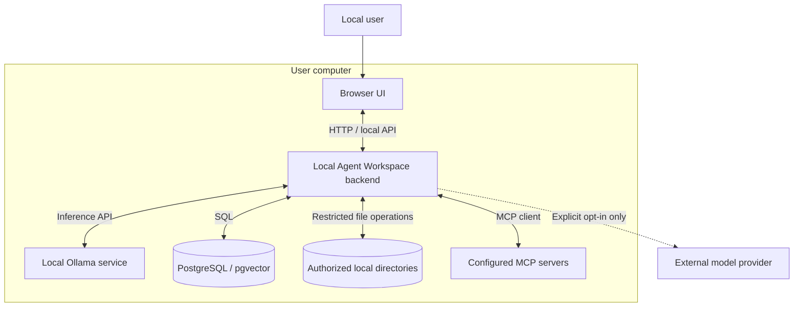
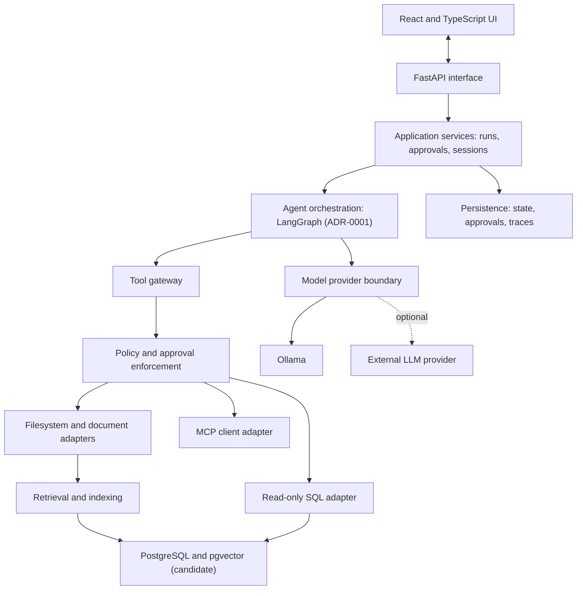
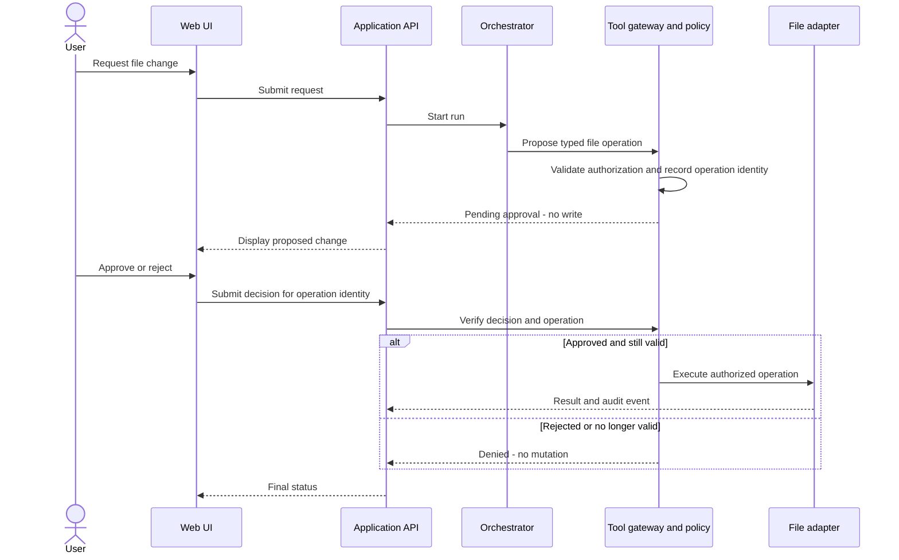

# Architecture Overview

**Product:** Local Agent Workspace  
**Status:** Accepted — initial architecture baseline  
**Related specifications:** [Product Requirements](../requirements/product-requirements.md) · [Software Requirements](../requirements/software-requirements.md)  
**Scope:** Target architecture for the initial single-user, local-first product; not an implementation-status report

## 1. Purpose and architectural drivers

Local Agent Workspace is a self-hosted assistant that enables a user to interact with authorized local documents, structured data, and extensible tools. This document records the accepted high-level system structure, responsibilities, interfaces, data flows, and principal trust boundaries. It is informed by ISO/IEC/IEEE 42010's separation of stakeholders, concerns, and architecture views, without claiming formal conformance.

Key drivers:

- **Local-first:** Core functionality must work without cloud infrastructure or external inference (G2; FR-003; NFR-001).
- **Modularity:** Model providers, document sources, and tools must have clear contracts (G3; FR-002; NFR-003).
- **Controlled actions:** Tools must operate inside enforced permissions; file writes need specific human approval (G4; SEC-001–SEC-003; SEC-010).
- **Bounded agent behavior:** Runs must support limits, interruption, and recovery (FR-012–FR-013; NFR-007).
- **Verifiability and observability:** Behavior must be traceable and testable independently of a live LLM (G5; NFR-004–NFR-006).
- **Reproducibility:** A developer can set up and test the application from its repository and documented configuration (G6; NFR-002).

### Stakeholders and concerns

| Stakeholder | Primary concerns |
| --- | --- |
| Local user | Useful outcomes, explainable activity, approval of changes, data locality |
| Maintainer/contributor | Simplicity, modular contracts, reproducible setup, testability |
| Security reviewer | Authorization boundaries, untrusted content, least privilege, auditability |
| Operator (initially the local user) | Startup, configuration, diagnostics, safe recovery and updates |

## 2. System context

The application is a **single-user, local-first** system, not a publicly exposed or multi-tenant service. The browser and local services run on the user's computer. Optional external model providers and future cloud document sources are outside the trusted local environment and require explicit configuration.

This diagram identifies dependencies, not mandatory process or container boundaries. In particular, an MCP server might execute locally in a child process; it must not be assumed trustworthy merely because it is local.

## 3. Logical component view

**Architectural style:** A modular Python backend behind a separate React/TypeScript web frontend. Components within the backend are logical modules, not microservices. PostgreSQL and the model runtime are external local services.

The diagram illustrates responsibilities, not an exact request call stack. The tool gateway must authorize each tool invocation **before** it reaches the implementation; approval decisions must be bound to the operation ultimately executed. A direct call to a tool adapter must not bypass enforcement. Read-only tools still require scope and capability checks.

### Component responsibilities

| Component | Responsibilities | Explicit exclusions |
| --- | --- | --- |
| Web UI | Chat, run-status display, approval review, user cancellation, configuration views | Does not enforce final authorization or handle secrets as trusted policy state |
| FastAPI interface | Validate requests, expose versioned HTTP contracts, dispatch run and approval commands | Does not contain agent or database business logic |
| Application services | Run lifecycle, coordination, cancellation, approval records, user-facing results | Does not delegate security decisions to prompts |
| Orchestration | Graph state, routing, bounded agent steps, interrupts and resumption | Does not grant tool permissions |
| Model-provider boundary | Configured inference, required capability checks, normalized usage/error metadata | Does not guarantee equivalent behavior across models |
| Tool gateway and policy enforcement | Typed invocation validation, per-tool permissions, limits, operation approval checks, audit events | Does not rely on model compliance for safety |
| File/document adapters | Safe directory-scoped reads, proposed changes, guarded writes, document extraction | No unrestricted host filesystem access or shell execution |
| SQL adapter | Schema inspection and read queries through a least-privileged database identity | No general administrative database operations |
| MCP adapter | Connect to explicitly configured servers; expose approved external tools through the gateway | No implicit trust of tool descriptions or remote responses |
| Retrieval/indexing | Ingestion, chunking, embeddings, indexes, relevant passages and provenance | No authority to overwrite source documents |
| Persistence | Durable run/checkpoint state where required, approval metadata, and appropriate diagnostic records | No default storage of secrets or raw sensitive traces |
| Observability/evaluation | Structured events, traces, metrics, reproducible scenario assessment | No assumption that an LLM-generated score is sufficient evidence |

## 4. Key behavioral views

### 4.1 Read-only query

1. The user submits a request via the UI and API.
2. Application services start a bounded run; the orchestrator selects a model or allowed tool.
3. The tool gateway validates argument shape, resource scope, and caller capabilities.
4. The adapter performs a read operation and returns typed results plus source metadata where applicable.
5. The agent prepares a response; the application exposes execution status and non-sensitive trace metadata.

For RAG, retrieval and generation are separate steps to enable diagnosis of retrieval versus generation errors. For SQL, read-only enforcement belongs to both the tool gateway and the database identity, not only to query-text inspection.

### 4.2 File write requiring approval

The final write authority stays within trusted application code. The implementation must address the interval between approval and execution (e.g., changed files, symlink replacement, retries). Retrying or resuming an orchestration node must not duplicate side effects. Exact mechanisms belong in a security/approval design ADR and require negative tests.

### 4.3 MCP tool invocation

MCP tool discovery and responses are untrusted inputs. Only explicitly configured MCP servers and explicitly permitted tool capabilities are exposed to agents. The tool gateway performs authorization before dispatch. Transport, sandboxing, and restrictions on externally hosted MCP servers will be defined separately. A capable MCP server must not become a path around local file or SQL restrictions.

## 5. State and data ownership

The architecture distinguishes:

- **Conversation state:** User messages and responses; long-term history is desirable but not mandatory in the first increment (FR-015).
- **Run state:** Graph steps, pending actions, budgets, errors, cancellations, and resumable checkpoints (FR-012–FR-013).
- **Authorization state:** An operation-specific decision and its validity, separate from LLM messages (SEC-002, SEC-010).
- **Source data:** Files under configured roots and a configured PostgreSQL database (FR-005, FR-007).
- **Retrieval data:** Derived text chunks, embeddings, metadata, and source references (FR-006).
- **Telemetry/evaluation data:** Sanitized events and reproducible evaluation metadata (NFR-004, NFR-006, SEC-011).

**Proposed persistence:** PostgreSQL with pgvector for structured records and retrieval; a durable checkpointer for resumable orchestration. Whether all state shares one PostgreSQL instance and which checkpoint backend to use remain design decisions. Do not store user documents in the repository. Indexes must be regenerable from authorized source material.

## 6. Trust boundaries and security controls

| Boundary | Principal risk | Required approach |
| --- | --- | --- |
| Browser → application API | Malicious or malformed requests, spoofed approval | Validate commands and approvals in the backend; local-only networking is not sufficient authorization |
| LLM → tool gateway | Hallucinated arguments, unsafe requests, excessive tool use | Typed validation, allowlists, budgets, per-operation authorization |
| Retrieved content → agent | Prompt injection / instruction laundering | Treat source material as data, never as a grant of permission |
| Backend → filesystem | Path traversal, symlink escape, modification after approval | Scoped roots, safe path and file-handle validation, race-aware writes and tests |
| Backend → database | Unauthorized SQL side effects, data overexposure | Dedicated least-privilege read identity, query/resource constraints |
| Backend → MCP server | Malicious tool declarations/results, privileged behavior | Explicit server trust configuration, capability allowlists, gateway enforcement |
| Backend → external provider (optional) | Disclosure of prompts, documents, or results | Explicit opt-in; explain and control data egress; no implicit fallback |
| Telemetry / persistent state | Sensitive content in logs or stored context | Redact or omit by default; restrictive access and retention decisions |

The accepted [initial threat model](../security/threat-model.md) records threat scenarios, mitigation directions, and residual design questions. Security tests shall validate enforcement independently of the model's instructions.

## 7. Deployment and development view

- Single-user operation on a development machine.
- React/TypeScript frontend, Python/FastAPI backend, locally runnable model service, and PostgreSQL service.
- Containerized infrastructure where practical, provisioned through Docker Compose; hosting of Ollama on the Windows host is allowed to avoid unnecessary GPU container complexity.
- Version-controlled source, dependency locks, configuration examples, database migrations, tests and MkDocs documentation; local secrets and user data stay outside version control.
- CI runs deterministic tests and checks without depending on a GPU, a paid API, or private documents.
- Public internet hosting, Kubernetes, Terraform-based cloud provisioning, and scheduled autonomous tasks are out of scope.

## 8. Architecture decisions and unresolved questions

The following architectural decisions are **accepted**. They describe intended design, not completed implementation.

| Decision | Accepted reference |
| --- | --- |
| LangGraph for agent orchestration, with standard Pydantic for typed contracts | [ADR-0001](adr/0001-use-langgraph-for-agent-orchestration.md) |
| Modular monolith for the backend | [ADR-0002](adr/0002-adopt-a-modular-monolith.md) |
| Centralized authorization and tool enforcement, including MCP tools | [ADR-0003](adr/0003-centralize-tool-authorization.md) |
| Configurable model providers with explicit capability checks | [ADR-0004](adr/0004-adopt-configurable-model-providers.md) |

The following **implementation/design questions remain open**:

| Topic | Current direction / next step |
| --- | --- |
| Storage and retrieval | PostgreSQL is required for structured data. The roadmap plans pgvector for M3; the diagram retains its candidate status because the detailed persistence/indexing decision remains open. Confirm that design before implementing M3. |
| MCP transport and isolation | Define server trust configuration, transport and process restrictions before implementing M6. |
| Writable formats | The accepted [roadmap](../project/development-roadmap.md) limits v1.0 writes to UTF-8 text, including Markdown and JSON as text; file-operation semantics require a detailed design. |
| MVP release boundary | The accepted [roadmap](../project/development-roadmap.md) establishes a read-only single-agent MVP after M2. |
| Approval state | Specify operation identity, durable storage, replay protection and crash-safe resumption before implementing M5. |

**No implementation or verification is asserted by this document.** Accepted architectural decisions are not implementation evidence.

## 9. Verification implications

Architecture reviews and tests should establish at minimum:

1. Core tools and security policies can be unit-tested without an LLM (NFR-005).
2. The same agent behavior can be invoked with different compatible model configurations (FR-002).
3. Forbidden file/SQL/MCP operations remain forbidden regardless of agent output (SEC-001–SEC-010).
4. Approval recovery, replay, cancellation and budgets behave predictably under failure (FR-012–FR-013; NFR-007).
5. Retrieval evaluations can attribute failures to document access, indexing/retrieval, or response generation (FR-006; NFR-006).
6. Logs and traces avoid secrets and sensitive documents by default (SEC-011).

The accepted development roadmap defines milestone acceptance and release gates. Detailed test IDs, evaluation fixtures, and quality thresholds remain to be defined alongside implementation and evaluation artifacts.

## 10. Related artifacts

- [Product Requirements Document](../requirements/product-requirements.md)
- [Software Requirements Specification](../requirements/software-requirements.md)
- [Accepted architecture decisions](adr/0001-use-langgraph-for-agent-orchestration.md) (ADR-0001–0004)
- [Initial threat model](../security/threat-model.md); security policy (planned)
- [Development roadmap](../project/development-roadmap.md); evaluation strategy (planned)
